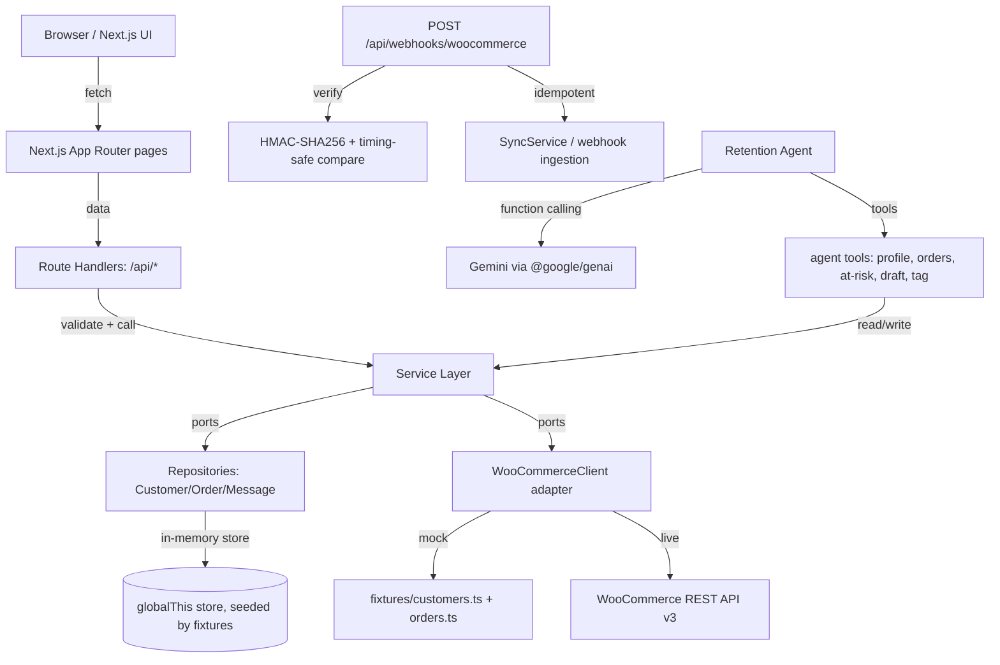

# Architecture — WooPulse CRM

## Diagram

## Layers
1. **Domain** — `src/domain`: pure types (`Customer`, `Order`, `Message`, `Segment`, `StatusEvent`, `AgentStep`, `AgentRun`). No framework code.
2. **Lib** — `src/lib`: zod schemas for runtime validation at boundaries (sync request, message create, agent tool args, webhook header).
3. **Integrations** — `src/integrations/woocommerce`: `WooCommerceClient` interface with two implementations: `MockWooCommerceClient` (fixtures) and `LiveWooCommerceClient` (REST API). Adapter pattern.
4. **Repositories** — `src/repositories`: `CustomerRepository`, `OrderRepository`, `MessageRepository`. Default implementation is an in-memory store on `globalThis`, seeded from fixtures. Documented swap point for Postgres/Supabase later.
5. **Services** — `src/services`: `CustomerService`, `OrderService`, `SegmentationService`, `CommunicationService`, `SyncService`, `DashboardService`. Route handlers stay thin: validate, call a service, return.
6. **Agent** — `src/agent`: Retention Agent tool-calling loop, tool definitions, fallback template drafts, step logging.
7. **UI** — `src/app` pages and `src/components`: dashboard, customers, orders, communications, agent panel.

## Patterns and why
- **Adapter (WooCommerceClient)**: decouples the app from the WooCommerce transport. Mock mode lets the demo run offline; live mode is a swap, not a refactor.
- **Repository**: isolates persistence from business logic. In-memory default keeps the demo fast and simple; the interface makes a real DB swap a matter of one implementation change.
- **Service layer**: keeps route handlers thin and testable. Business rules (segmentation, sync upsert, message workflow) live in services, not in pages.
- **Strategy (segmentation)**: segment rules are configurable and isolated, so thresholds can change without touching consumers.
- **Domain types in `src/domain`**: prevents framework leakage into business concepts; the rest of the app depends on stable domain shapes.
- **Zod at boundaries**: validates external input (webhooks, API requests, agent tool args) before it reaches services.
- **Human-in-the-loop for sending**: the agent drafts only; a human approves in the UI. This is both a safety constraint and a judging criterion (effective, correct AI usage + agentic AI with guardrails).

## Data flow highlights
- **Sync**: the sync route calls `SyncService`, which uses the client adapter to pull customers/orders and upserts them idempotently into the repositories. Mock mode reads fixtures; live mode calls the REST API.
- **Webhooks**: `POST /api/webhooks/woocommerce` verifies `X-WC-Webhook-Signature` using the raw body and the webhook secret, timing-safe, and rejects with 401 on failure. Valid payloads are ingested idempotently by order id / customer id.
- **Dashboard**: `GET /api/dashboard` aggregates customers, orders, revenue, at-risk count, segment breakdown, and recent orders from repositories.
- **Retention Agent**: when triggered, the agent loop calls Gemini with function tools. Each tool call is validated with zod, executed against services/repos, and streamed to the "Agent activity" panel. On error or missing API key, a deterministic template fallback produces drafts so the demo never breaks.
